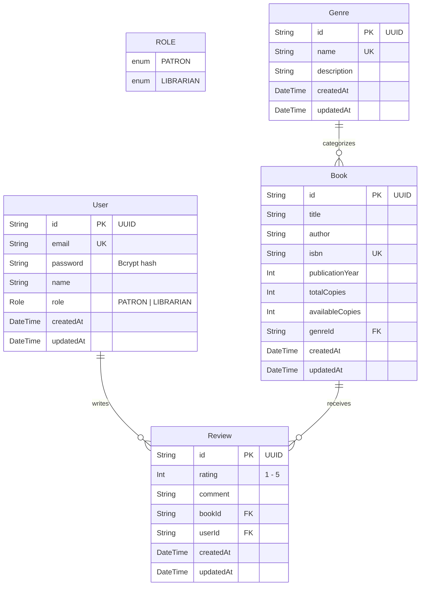

# Library Management System - Backend & Book Catalog

A robust, enterprise-grade RESTful API and relational data layer for a library management system built with **NestJS**, **TypeScript**, **Prisma ORM**, and **PostgreSQL**.

---

## Table of Contents

- [Overview](#overview)
- [Project Structure](#project-structure)
- [Entity-Relationship Diagram](#entity-relationship-diagram)
- [Data Models](#data-models)
  - [Role Enum](#role-enum)
  - [User Model](#user-model)
  - [Genre Model](#genre-model)
  - [Book Model](#book-model)
  - [Review Model](#review-model)
- [Schema Decisions](#schema-decisions)
  - [Why Book References Genre Rather Than Embedding It](#why-book-references-genre-rather-than-embedding-it)
- [Comparative Reflection: Prisma vs. Document Databases](#comparative-reflection-prisma-vs-document-databases)
- [Authentication & Role-Based Access Control](#authentication--role-based-access-control)
  - [Bcrypt Password Hashing](#bcrypt-password-hashing)
  - [JWT Strategy & JwtAuthGuard](#jwt-strategy--jwtauthguard)
  - [Roles Decorator & RolesGuard](#roles-decorator--rolesguard)
  - [Rate Limiting (Stretch Goal)](#rate-limiting-stretch-goal)
- [API Endpoints](#api-endpoints)
  - [Authentication Routes](#authentication-routes)
  - [Users Routes (Stretch Goal)](#users-routes-stretch-goal)
  - [Genre CRUD Routes](#genre-crud-routes)
  - [Book Catalog Routes](#book-catalog-routes)
- [Query Filtering, Search & Pagination](#query-filtering-search--pagination)
- [DTO Validation](#dto-validation)
- [Postman Collection](#postman-collection)
- [Getting Started](#getting-started)
  - [1. Prerequisites](#1-prerequisites)
  - [2. Installation](#2-installation)
  - [3. Configure Environment Variables](#3-configure-environment-variables)
  - [4. Generate Prisma Client](#4-generate-prisma-client)
  - [5. Run Migrations & Seed](#5-run-migrations--seed)
  - [6. Start the Server](#6-start-the-server)
- [Verification & Checklist](#verification--checklist)

---

## Overview

This project delivers the full backend core for a library catalog management system:
- **Full Genre CRUD**: Create, read (list and individual), update, and delete catalog genres.
- **Advanced Book Catalog**: Full book management featuring search by title or author, category/genre filtering, and offset-based pagination.
- **Authentication & Security**: Secure registration and login issuing signed JSON Web Tokens (JWTs), with passwords hashed using salt-rounds-backed **bcrypt**.
- **Role-Based Authorization (RBAC)**: Fine-grained access control with `@Roles()` decorator and `RolesGuard`, restricting book mutations to `LIBRARIAN` accounts.
- **DTO Validation**: Strict runtime request validation using `class-validator` and `ValidationPipe({ whitelist: true })`.
- **Rate Limiting**: Anti-brute-force rate limiting on `/auth/login` using `@nestjs/throttler`.
- **User Profile**: Protected `/users/profile` endpoint extracting user identity using `@Req()`.

---

## Project Structure

```
library-management-system/
├── api/
│   ├── .env.example                     # Environment template (DATABASE_URL, JWT_SECRET, PORT)
│   ├── .gitignore                       # Ignores .env, node_modules, dist/
│   ├── package.json                     # Dependencies, scripts, and Prisma seed configuration
│   ├── tsconfig.json                    # TypeScript compiler configuration
│   ├── prisma/
│   │   ├── schema.prisma                # Relational schema (PostgreSQL)
│   │   └── seed.ts                      # Database seed script (5 genres, 17 books, users, reviews)
│   └── src/
│       ├── main.ts                      # Bootstrap: ValidationPipe & CORS configured
│       ├── app.module.ts                # Root application module
│       ├── prisma/
│       │   ├── prisma.service.ts        # PrismaService extending PrismaClient & OnModuleInit
│       │   └── prisma.module.ts         # Global module exporting PrismaService
│       ├── auth/
│       │   ├── dto/
│       │   │   ├── register.dto.ts      # Validates email, password (min 6), name, optional role
│       │   │   └── login.dto.ts         # Validates email and password
│       │   ├── auth.controller.ts       # POST /auth/register & POST /auth/login (throttled)
│       │   ├── auth.service.ts          # Hashes passwords with bcrypt, verifies, signs JWT
│       │   ├── auth.module.ts           # Configures Passport, JwtModule, Throttler
│       │   ├── jwt.strategy.ts          # Verifies tokens using JWT_SECRET
│       │   ├── jwt-auth.guard.ts        # AuthGuard('jwt') wrapper
│       │   ├── roles.decorator.ts       # @Roles() metadata decorator
│       │   └── roles.guard.ts           # Guards routes checking req.user.role
│       ├── genres/
│       │   ├── dto/
│       │   │   ├── create-genre.dto.ts  # Validates name and optional description
│       │   │   └── update-genre.dto.ts  # PartialType(CreateGenreDto)
│       │   ├── genres.controller.ts     # Full CRUD (create, findAll, findOne, update, remove)
│       │   ├── genres.service.ts        # Business logic & Prisma operations
│       │   └── genres.module.ts
│       ├── books/
│       │   ├── dto/
│       │   │   ├── create-book.dto.ts   # class-validator on title, author, isbn, totalCopies, genreId
│       │   │   └── update-book.dto.ts   # PartialType(CreateBookDto)
│       │   ├── books.controller.ts      # GET (reads genreId, search, page, limit); guarded POST/PATCH/DELETE
│       │   ├── books.service.ts         # Builds Prisma where clause & applies skip/take
│       │   └── books.module.ts
│       └── users/
│           ├── users.controller.ts      # GET /users/profile using @Req()
│           ├── users.service.ts
│           └── users.module.ts
├── docs/
│   └── postman_collection.json          # Postman collection for every endpoint built
├── .gitignore
└── README.md
```

---

## Entity-Relationship Diagram



---

## Data Models

### Role Enum
Defines permissions across the application:
- `PATRON`: Standard library member capable of browsing books, searching, and submitting reviews.
- `LIBRARIAN`: Administrative staff with catalog maintenance, book inventory management, and circulation privileges.

```prisma
enum Role {
  PATRON
  LIBRARIAN
}
```

### User Model
Represents library patrons and staff with hashed passwords and role assignment.

```prisma
model User {
  id        String   @id @default(uuid())
  email     String   @unique
  name      String
  password  String   @default("")
  role      Role     @default(PATRON)
  createdAt DateTime @default(now())
  updatedAt DateTime @updatedAt

  reviews   Review[]

  @@map("users")
}
```

### Genre Model
Acts as a centralized taxonomy entity for books. Enforces unique genre names.

```prisma
model Genre {
  id          String   @id @default(uuid())
  name        String   @unique
  description String?
  createdAt   DateTime @default(now())
  updatedAt   DateTime @updatedAt

  books       Book[]

  @@map("genres")
}
```

### Book Model
Contains catalog metadata, total copies, available copies, and foreign key `genreId` referencing `Genre`.

```prisma
model Book {
  id              String   @id @default(uuid())
  title           String
  author          String
  isbn            String   @unique
  publicationYear Int?
  totalCopies     Int      @default(1)
  availableCopies Int      @default(1)
  genreId         String
  createdAt       DateTime @default(now())
  updatedAt       DateTime @updatedAt

  genre           Genre    @relation(fields: [genreId], references: [id], onDelete: Cascade)
  reviews         Review[]

  @@map("books")
}
```

### Review Model
Enables patrons to rate and comment on books. Relates to `Book` and `User`.

```prisma
model Review {
  id        String   @id @default(uuid())
  rating    Int
  comment   String?
  bookId    String
  userId    String
  createdAt DateTime @default(now())
  updatedAt DateTime @updatedAt

  book      Book     @relation(fields: [bookId], references: [id], onDelete: Cascade)
  user      User     @relation(fields: [userId], references: [id], onDelete: Cascade)

  @@map("reviews")
}
```

---

## Schema Decisions

### Why Book References Genre Rather Than Embedding It

In relational database design (and specifically within PostgreSQL using Prisma), determining whether to normalize data through foreign key references (`Genre` as an independent entity referenced by `Book.genreId`) versus embedding it (e.g., storing `genre: "Science Fiction"` or a embedded sub-document) is a foundational design choice.

We deliberately decided to model `Genre` as a dedicated entity and reference it via a foreign key with `@relation`. The architectural reasons are detailed below:

#### 1. Elimination of Data Redundancy and Storage Optimization
Embedding genre data directly inside each book record leads to massive duplication. If 10,000 books belong to `"Science Fiction"`, storing the genre name and descriptive text repeatedly consumes unnecessary disk and cache space. Storing a single canonical `Genre` record and referencing it by foreign key (`genreId`) adheres strictly to relational normalization principles.

#### 2. Prevention of Update and Modification Anomalies (Third Normal Form - 3NF)
In an embedded design, if a librarian wants to correct or refine a genre name (for example, renaming `"Sci-Fi"` to `"Science Fiction"`, or updating its scope description), the application would have to locate and update thousands of individual book records. This creates severe performance overhead and risks data inconsistencies if an update fails midway. With a referenced relation:
$$\text{Single Row Update: } \mathcal{O}(1)$$
Updating a single row in the `genres` table immediately reflects across all associated books without touching the `books` table.

#### 3. Strict Referential Integrity and Typo Prevention
By enforcing a foreign key constraint (`@relation(fields: [genreId], references: [id])`), the database engine prevents orphan records and human error. Patrons and catalog managers cannot inadvertently create books with fragmented variants such as `"SciFi"`, `"scifi"`, `"Science-Fiction"`, or non-existent categories. Every book is guaranteed to point to a valid, existing genre.

#### 4. First-Class Domain Capabilities for Genres
Treating `Genre` as a distinct entity allows the library system to extend category features easily in the future, including:
- Rich descriptive summaries and curation notes.
- Physical library location metadata (e.g., floor, aisle, call number ranges).
- Taxonomy hierarchies (parent genres and sub-genres).
- Direct querying and catalog indexing of all available genres, even if some currently have zero books assigned.

#### 5. Efficient Indexing and Relational Query Performance
PostgreSQL excels at indexed joins. By indexing `genreId`, filtering books by genre (`WHERE genreId = ...`) or aggregating inventory statistics by genre (`COUNT(books) GROUP BY genreId`) is performed with high-efficiency b-tree index lookups rather than costly full-table text scans.

---

## Comparative Reflection: Prisma vs. Document Databases

> **Stretch Note:** Key operational and conceptual differences experienced when modeling in Prisma (Relational / SQL) versus a Document Database (e.g., MongoDB / Mongoose).

1. **Schema Enforcement at the Database Engine Level vs. Application Level**:
   In document databases like MongoDB, documents in a collection are inherently schema-less at the storage layer; validations are usually enforced at the application runtime (e.g., via Mongoose schemas or JSON Schema validators). In contrast, Prisma's declarative schema directly maps to strict SQL DDL constraints (`NOT NULL`, `FOREIGN KEY`, `UNIQUE`, and `CHECK` constraints) enforced directly by the PostgreSQL engine. Attempting to violate a constraint fails deterministically at the database level.

2. **Relations and Referential Integrity vs. Denormalized Embedding**:
   In document databases, the default modeling pattern often favors **embedding** related data inside parent documents (e.g., nesting an array of reviews or category tags inside a book document) to optimize for single-document reads. In Prisma with PostgreSQL, relations are modeled explicitly using foreign keys, join tables, or relation fields (`@relation`). While document databases require manual logic to clean up dangling references if a parent entity is deleted, Prisma and PostgreSQL handle integrity natively with declarative actions like `onDelete: Cascade`.

3. **Migration Discipline vs. Schema Flexibility**:
   Evolving data structures in Prisma requires creating version-tracked SQL migrations (`prisma migrate dev`), providing an auditable, deterministic migration trail across staging and production environments. Document stores allow arbitrary fields to be added on the fly, offering rapid prototyping speed at the cost of requiring legacy-document data cleanup scripts later on.

---

## Authentication & Role-Based Access Control

### Bcrypt Password Hashing
All user passwords submitted during registration (`POST /auth/register`) are salted and hashed using `bcrypt` (10 rounds) before persisting to PostgreSQL. Plaintext passwords are never saved or returned in API responses.

### JWT Strategy & JwtAuthGuard
- **`JwtStrategy`** (`api/src/auth/jwt.strategy.ts`): Extends `PassportStrategy(Strategy)`. Extracts the bearer token from the `Authorization` header, verifies the signature against `JWT_SECRET`, and verifies that the subject user still exists in PostgreSQL.
- **`JwtAuthGuard`** (`api/src/auth/jwt-auth.guard.ts`): Extends `AuthGuard('jwt')`, enabling route protection via `@UseGuards(JwtAuthGuard)`.

### Roles Decorator & RolesGuard
- **`@Roles()`** (`api/src/auth/roles.decorator.ts`): Attaches required role metadata (e.g. `@Roles(Role.LIBRARIAN)`) to route handlers.
- **`RolesGuard`** (`api/src/auth/roles.guard.ts`): Implements `CanActivate`. Retrieves role requirements using NestJS `Reflector`, extracts `req.user.role`, and rejects non-matching accounts with a `403 ForbiddenException`.

### Rate Limiting (Stretch Goal)
The `POST /auth/login` endpoint is rate limited using `@nestjs/throttler` (`@UseGuards(ThrottlerGuard)` and `@Throttle({ default: { limit: 5, ttl: 60000 } })`) to protect against brute-force credential stuffing.

---

## API Endpoints

### Authentication Routes
| Method | Endpoint | Access | Description |
| :--- | :--- | :--- | :--- |
| `POST` | `/auth/register` | Public | Register a new user (`email`, `password`, `name`, optional `role`). |
| `POST` | `/auth/login` | Public (Throttled) | Authenticate user credentials and return `{ access_token, user }`. |

### Users Routes (Stretch Goal)
| Method | Endpoint | Access | Description |
| :--- | :--- | :--- | :--- |
| `GET` | `/users/profile` | Authenticated (JWT) | Returns current authenticated user via `@Req() req.user`. |

### Genre CRUD Routes
| Method | Endpoint | Access | Description |
| :--- | :--- | :--- | :--- |
| `POST` | `/genres` | Public / Admin | Create a new genre with `CreateGenreDto`. |
| `GET` | `/genres` | Public | Retrieve all genres with count of books. |
| `GET` | `/genres/:id` | Public | Retrieve a single genre by UUID with its books. |
| `PATCH` | `/genres/:id` | Public / Admin | Update a genre name or description with `UpdateGenreDto`. |
| `DELETE` | `/genres/:id` | Public / Admin | Remove a genre by ID (cascades to books). |

### Book Catalog Routes
| Method | Endpoint | Access | Description |
| :--- | :--- | :--- | :--- |
| `GET` | `/books` | Public | List books with query filtering (`genreId`), search (`search`), and pagination (`page`, `limit`). |
| `GET` | `/books/:id` | Public | Retrieve a book by UUID including genre and reviews. |
| `POST` | `/books` | **Guarded (Librarian)** | Create a book with `CreateBookDto`. |
| `PATCH` | `/books/:id` | **Guarded (Librarian)** | Update book details with `UpdateBookDto`. |
| `DELETE` | `/books/:id` | **Guarded (Librarian)** | Remove a book from the catalog. |

---

## Query Filtering, Search & Pagination

The `GET /books` endpoint accepts the following query parameters:

- `genreId` *(optional string)*: Filters books belonging to a specific genre UUID.
- `search` *(optional string)*: Case-insensitive search matching against book `title` OR `author`.
- `page` *(optional integer, default: 1)*: Page number for pagination.
- `limit` *(optional integer, default: 10)*: Number of books per page.

### Implementation in `BooksService`:
```typescript
const where: Prisma.BookWhereInput = {};

if (genreId) {
  where.genreId = genreId;
}

if (search) {
  where.OR = [
    { title: { contains: search, mode: 'insensitive' } },
    { author: { contains: search, mode: 'insensitive' } },
  ];
}

const pageNumber = page ? Math.max(1, Number(page)) : 1;
const pageSize = limit ? Math.max(1, Number(limit)) : 10;
const skip = (pageNumber - 1) * pageSize;
const take = pageSize;

const [books, total] = await Promise.all([
  this.prisma.book.findMany({ where, skip, take, include: { genre: true }, orderBy: { createdAt: 'desc' } }),
  this.prisma.book.count({ where }),
]);
```

---

## DTO Validation

All incoming request payloads are automatically validated via the global `ValidationPipe({ whitelist: true })`:

- **`CreateBookDto`**:
  - `title`: `@IsString() @IsNotEmpty()`
  - `author`: `@IsString() @IsNotEmpty()`
  - `isbn`: `@IsString() @IsNotEmpty()`
  - `totalCopies`: `@IsInt() @IsPositive() @Min(1)`
  - `genreId`: `@IsString() @IsNotEmpty() @IsUUID()`
  - `publicationYear`: `@IsOptional() @IsInt()`
- **`CreateGenreDto`**:
  - `name`: `@IsString() @IsNotEmpty()`
  - `description`: `@IsOptional() @IsString()`
- **`RegisterDto`**:
  - `email`: `@IsEmail() @IsNotEmpty()`
  - `password`: `@IsString() @IsNotEmpty() @MinLength(6)`
  - `name`: `@IsString() @IsNotEmpty()`
  - `role`: `@IsOptional() @IsEnum(Role)`

---

## Postman Collection

The Postman collection is located at [`docs/postman_collection.json`](file:///c:/Users/HomePC/Desktop/PLP/library-management-system/docs/postman_collection.json).

It includes preconfigured requests with automatic environment variable capture for:
1. `POST /auth/register` (Patron and Librarian registration)
2. `POST /auth/login` (Automatically saves `patronToken` and `librarianToken`)
3. `GET /users/profile` (Using Bearer authorization)
4. Full `Genre` CRUD (`POST`, `GET`, `GET :id`, `PATCH :id`, `DELETE :id`)
5. Full `Book` catalog (`GET` with search/pagination/filters, `GET :id`, guarded `POST`, guarded `PATCH`, guarded `DELETE`)

---

## Getting Started

### 1. Prerequisites
- **Node.js**: `v18.x`, `v20.x`, or `v22.x`
- **PostgreSQL**: Local instance or hosted service (e.g., Supabase, Neon, Railway)

### 2. Installation
```bash
cd api
npm install
```

### 3. Configure Environment Variables
Copy `.env.example` to `.env`:
```bash
cp .env.example .env
```
Edit `.env` with your PostgreSQL database URL and JWT secret:
```env
DATABASE_URL="postgresql://<username>:<password>@<host>:<port>/<dbname>?schema=public"
JWT_SECRET="your-super-secret-jwt-key"
PORT=3000
```

### 4. Generate Prisma Client
```bash
npm run prisma:generate
```

### 5. Run Migrations & Seed
```bash
npm run prisma:migrate
npm run prisma:seed
```

### 6. Start the Server
```bash
# Production build & run
npm run build
npm start

# Or development mode with auto-reload
npm run start:dev
```

The API will be available at `http://localhost:3000`.

---

## Verification & Checklist

| Requirement | Target File | Status |
| :--- | :--- | :---: |
| **Full CRUD for Genre** | `api/src/genres/genres.controller.ts, genres.service.ts, genres.module.ts` | ✅ |
| **`CreateBookDto` class-validator on all fields** (`title`, `author`, `isbn`, `totalCopies`, `genreId`) | `api/src/books/dto/create-book.dto.ts` | ✅ |
| **`GET /books` reads `genreId`, `search`, `page`, `limit` from `@Query()`** | `api/src/books/books.controller.ts` | ✅ |
| **Guarded `POST/PATCH/DELETE` on `/books`** | `api/src/books/books.controller.ts` | ✅ |
| **`findAll()` builds Prisma `where` & applies `skip/take`** | `api/src/books/books.service.ts` | ✅ |
| **`POST /auth/register` & `POST /auth/login` with bcrypt password hashing** | `api/src/auth/auth.controller.ts, auth.service.ts, auth.module.ts` | ✅ |
| **`JwtStrategy` verifies tokens with `JWT_SECRET`; `JwtAuthGuard` extends `AuthGuard('jwt')`** | `api/src/auth/jwt.strategy.ts, jwt-auth.guard.ts` | ✅ |
| **`@Roles()` decorator + `RolesGuard` checking `req.user.role`** | `api/src/auth/roles.decorator.ts, roles.guard.ts` | ✅ |
| **`ValidationPipe({ whitelist: true })` & `enableCors()` in `main.ts`** | `api/src/main.ts` | ✅ |
| **Collection for every endpoint built** | `docs/postman_collection.json` | ✅ |
| **Stretch: `GET /users/profile` using `@Req()`** | `api/src/users/users.controller.ts` | ✅ |
| **Stretch: Rate limit login with `@nestjs/throttler`** | `api/src/auth/auth.controller.ts` | ✅ |
| **Schema Decisions & Comparative Reflection** | `README.md` | ✅ |
